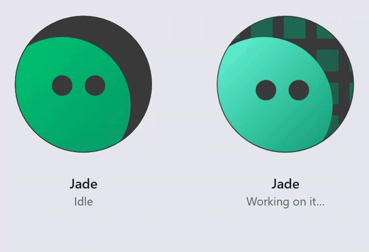
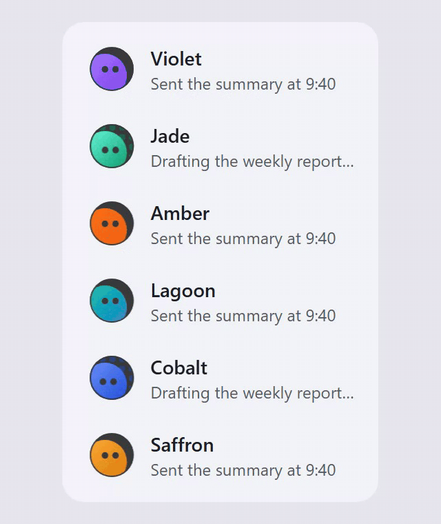

# Window avatar

A bot avatar with a working state that says "busy" through light rather than through motion of the body.

**Live demo:** https://window-avatar.vercel.app

- A face at a window: a fixed dark disc, and a coloured face offset so only a crescent shows. The colour is the only thing that tells two bots apart.
- **Idle:** completely still.
- **Working:** the face stays put, the window behind it lights up with a grid swept by a wavefront in the bot's colour, and the eyes search as a level pair. The name and status line pick up a matching shimmer.
- Per-avatar timing from a hash of the id, so a row of working bots does not move in unison.
- `prefers-reduced-motion: reduce` turns all motion off.

`index.html` is a single self-contained build of the live React component.

## Credits

The working-state grid is adapted from [gradient-spin](https://github.com/BIAsia/gradient-spin) (MIT).

## License

[MIT](LICENSE). The bundled demo also includes third-party libraries such as React, which keep their own licenses.
